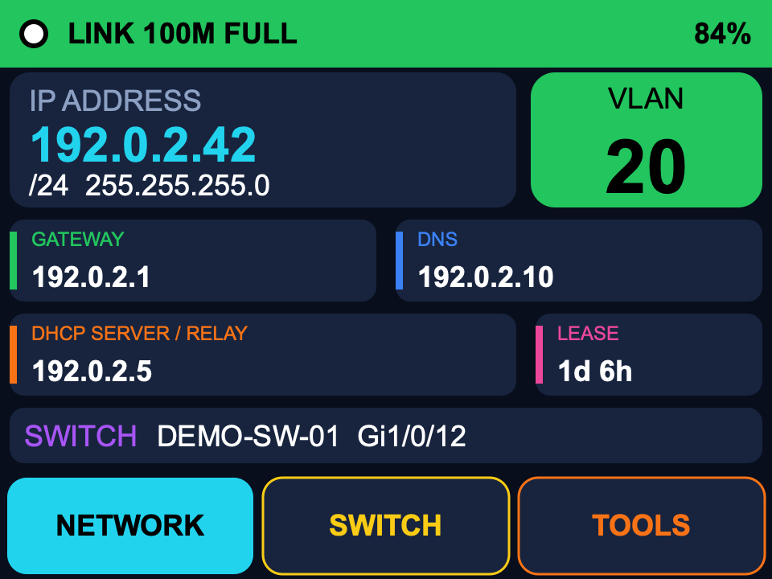
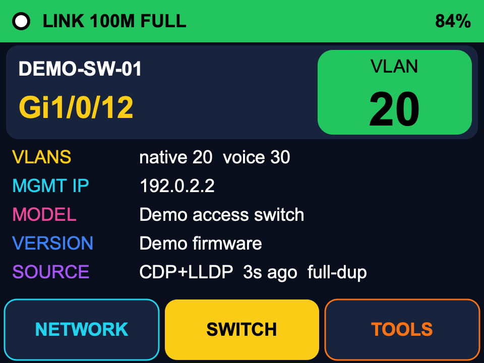
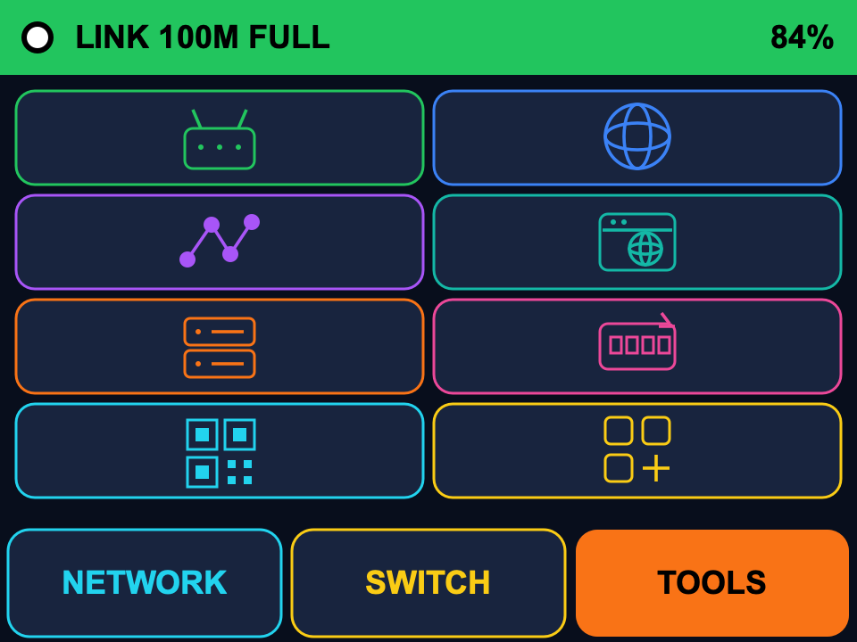
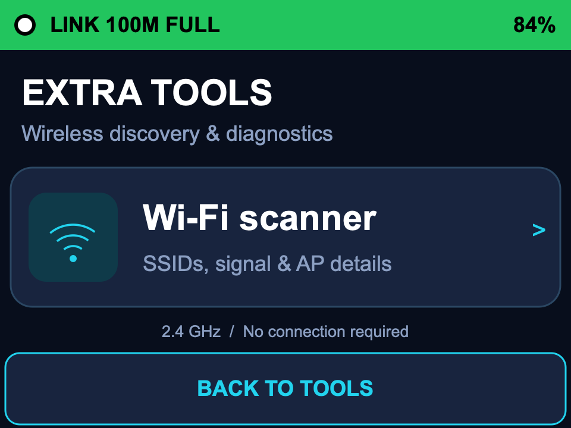
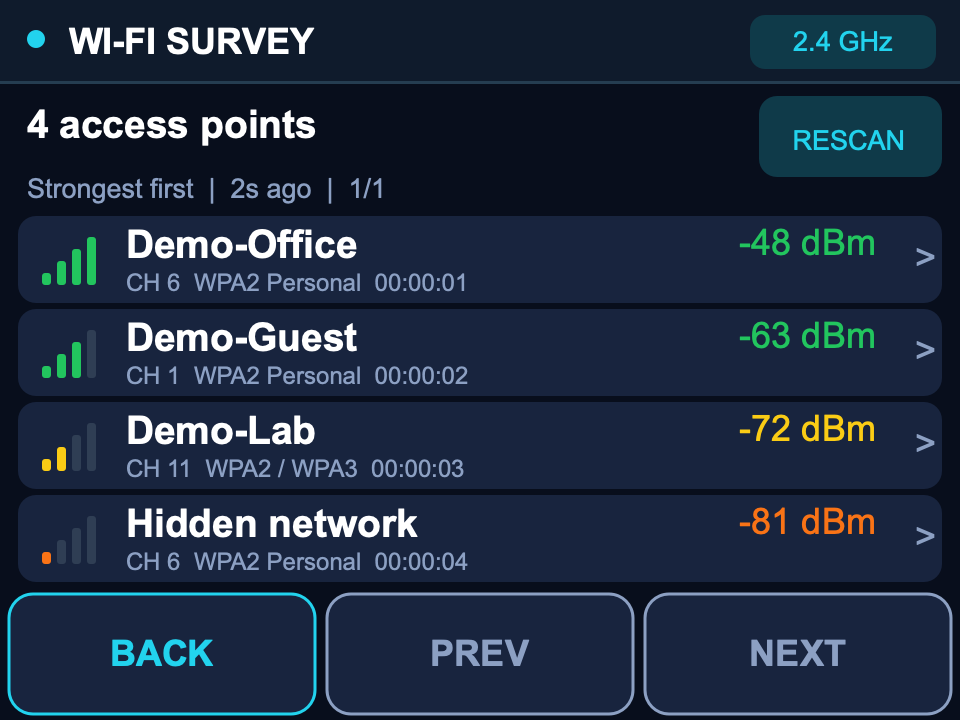
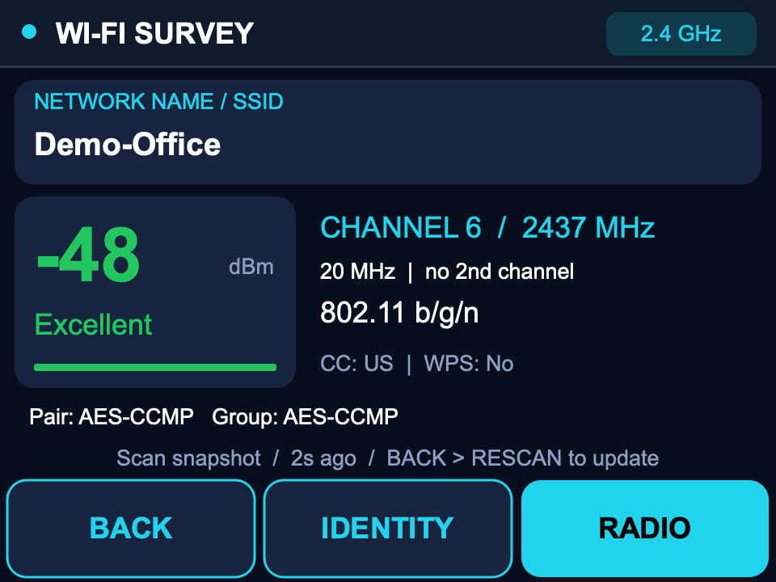
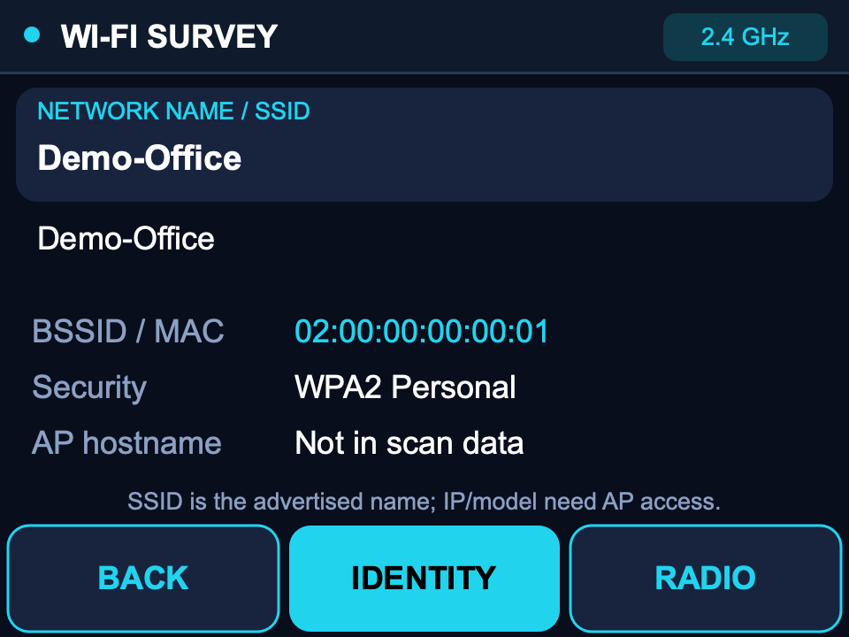
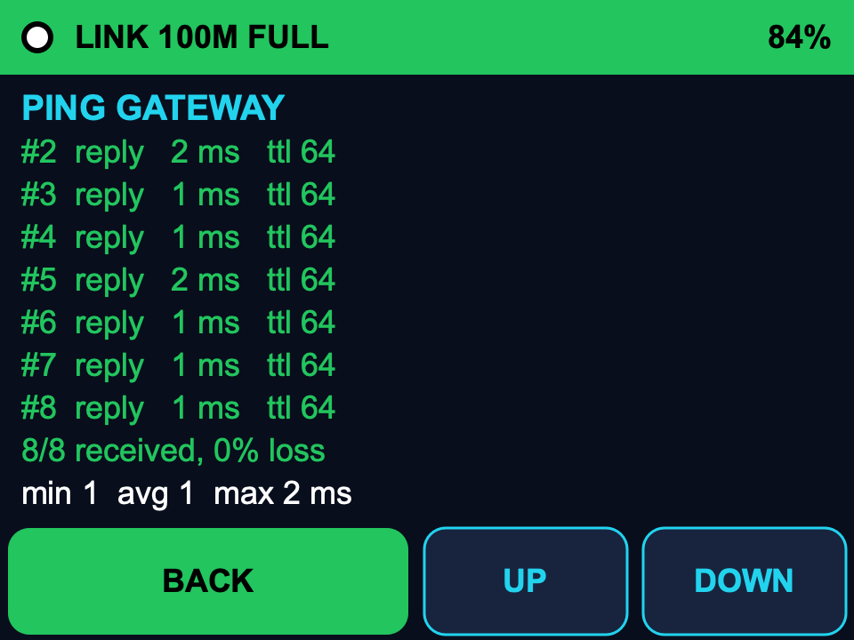

# Net-Tool · M5Stack Core2

A pocket network diagnostic tool for identifying switch ports, checking DHCP and VLAN information, testing connectivity, and surveying nearby Wi-Fi access points.

Built for the **M5Stack Core2** with a **W5500 Ethernet module**, using a touch interface, large status cards, and an icon-based tools menu. Firmware starts automatically when the device powers on. The Wi-Fi scanner also works without an Ethernet module or cable.

[Hardware](#hardware) · [Build and flash](#build-and-flash) · [Demo screens](#demo-screens) · [Using-net-tool](#using-net-tool) · [Troubleshooting](#troubleshooting) · [Limitations](#limitations)

## Demo screens

These are **illustrative demo renderings**, using the layout, colors, controls, and navigation in the current firmware. They contain synthetic addresses, SSIDs, and results; they are not photographs or captures from a connected device. Font rendering may differ on the physical LCD. Each PNG is rendered at 960 × 720 from the 320 × 240 layout.

| Network overview | Switch identification |
| :---: | :---: |
|  |  |
| **Tools menu** | **Extra tools** |
|  |  |
| **Wi-Fi access point list** | **Wi-Fi radio details** |
|  |  |
| **Wi-Fi identity** | **Ping results** |
|  |  |

The demo images can be regenerated on macOS with `swift scripts/render-demo.swift`. They are maintained illustrations, so update the renderer when changing the firmware UI. The earlier [network concept](Core2_Network_Home_Preview.svg) and [tools concept](Core2_UI_Preview.svg) are also included.

## Features

- **Ethernet overview:** link speed and duplex, assigned IPv4 address and subnet, gateway, DNS, DHCP server/relay, and lease information.
- **Switch identification:** decode CDP and LLDP advertisements for switch name, connected port, management IP, model, software, and VLAN information when advertised. CDP is preferred, with missing fields filled from LLDP.
- **VLAN visibility:** native/port VLAN, voice VLAN, and up to eight observed 802.1Q VLAN IDs.
- **Connectivity tests:** gateway and internet ping, ICMP traceroute, DNS lookups, and an HTTP connectivity check.
- **DHCP survey:** display up to four responding DHCP server offers and highlight multiple responders.
- **Port identification:** blink the connected switch port by cycling the Ethernet link.
- **QR handoff:** display discovered port and network information as text in a QR code for a phone camera.
- **Wi-Fi survey:** passive 2.4 GHz scanning, strongest-first AP list, and separate identity/radio detail pages.

## Hardware

### M5Stack Core2

The target is the original **Core2 (K010)**, an ESP32 development unit with a 2-inch, 320 × 240 capacitive touch display, USB-C programming, 16 MB flash, and 8 MB PSRAM. Its built-in Wi-Fi radio supports 2.4 GHz. The firmware uses the display and three lower touch zones, battery status, and vibration feedback. Audio is enabled only in the profile that does not reserve the speaker pin for Ethernet reset.

The Core2 does **not** have a built-in RJ45 port. Wired functions need an external W5500 module. Other M5Stack boards, including CoreS3, are not configured as build targets in this repository.

### Ethernet modules and pin profiles

The default build is **`core2-lan-13_2`**, for the LAN Module 13.2. Match the physical module's jumper settings to the selected profile.

| Module / profile | PlatformIO environment | CS | Reset | Interrupt | Notes |
| --- | --- | ---: | ---: | ---: | --- |
| LAN Module 13.2, expected factory jumper mapping | `core2-lan-13_2` | 33 | 0 | 35 | Default; speaker disabled because GPIO0 is used for W5500 reset |
| Legacy LAN Base / LAN PoE Base pin configuration | `core2-lan-base` | 26 | 19 | 34 | Alternate electrical profile; check mechanical compatibility before use |

Shared SPI signals: **SCK 18 · MISO 38 · MOSI 23**. Pin definitions live in [platformio.ini](platformio.ini).

**Physical assembly matters:** M5Stack's Core2 documentation says its vibration motor interferes with Base-series bases and advises against stacking them directly. A firmware pin profile does not establish mechanical compatibility. The vendor also gives specific bottom/battery assembly guidance for stacking modules; follow the instructions for your exact hardware revision.

The W5500 supports **10/100 Mbps Ethernet**. A compatible gigabit switch port will negotiate at 100 Mbps; this does not measure the cable's gigabit capability. Powering the unit from PoE requires appropriate PoE-capable hardware. The standard LAN Module 13.2 should not be assumed to provide PoE power.

### What you need

- M5Stack Core2 and a compatible W5500 module for wired tests.
- USB-C **data** cable for programming and serial diagnostics.
- Ethernet patch lead and an enabled switch port; DHCP is needed for the IP tests.
- PlatformIO Core CLI or the PlatformIO extension for VS Code.

A microSD card, Wi-Fi credentials, and cloud account are not required for normal operation.

## Build and flash

### 1. Get the source

```bash
git clone https://github.com/gmaree1/Net-Tool.git
cd Net-Tool
```

### 2. Install PlatformIO

Use the PlatformIO extension in VS Code, or install the CLI in a Python virtual environment. Example for macOS/Linux with a compatible Python installation:

```bash
python3 -m venv ~/.venvs/net-tool
source ~/.venvs/net-tool/bin/activate
python -m pip install platformio
```

If PlatformIO is already installed in its standard virtual environment, use `~/.platformio/penv/bin/pio` in place of `pio` below.

The project declares `espressif32@^6.9.0`, board `m5stack-core2`, the Arduino framework, and `M5Unified@^0.2.2`. These are compatible version ranges, rather than exact dependency locks. PlatformIO resolves the dependencies on the first build.

### 3. Build the matching profile

```bash
# Default: LAN Module 13.2
pio run -e core2-lan-13_2

# Alternate legacy pin profile
pio run -e core2-lan-base
```

Build products and downloaded project libraries are directed to `~/.cache/pio-build/net-tool/` by [platformio.ini](platformio.ini), keeping generated files outside the source folder. Change `build_dir` and `libdeps_dir` there if your environment needs another location.

### 4. Find the USB port and upload

Connect the Core2 with a USB data cable:

```bash
pio device list
pio run -e core2-lan-13_2 -t upload
```

If multiple serial devices are present, select the actual port explicitly:

```bash
pio run -e core2-lan-13_2 -t upload --upload-port /dev/cu.YOUR_DEVICE
pio device monitor --port /dev/cu.YOUR_DEVICE --baud 115200
```

Replace `/dev/cu.YOUR_DEVICE` with a port reported by `pio device list`. On macOS, `ls /dev/cu.*` is another quick check. `/dev/cu.debug-console` alone does not establish that the Core2 is connected.

Serial diagnostics use **115200 baud**. The configured upload speed is **1500000 baud**; reduce `upload_speed` in `platformio.ini` if uploads are unreliable. Close any serial monitor before uploading.

Uploading replaces the firmware on the device. No separate filesystem upload is needed for this version.

## Using Net-Tool

1. Power on the Core2 and connect its Ethernet module to a switch port.
2. Wait for link and DHCP. The status bar is **red** for no module/link, **orange** for link without an IP, and **green** when an IP has been obtained. Green does not by itself prove internet access.
3. Open **NETWORK** for addressing and VLAN information, or **SWITCH** for the connected switch and port.
4. Allow time for CDP/LLDP advertisements. The UI suggests 30–60 seconds; the actual interval depends on switch configuration. Discovery can work even if DHCP fails.
5. Open **TOOLS** for a diagnostic, or the bottom-right **Extra tools** tile for Wi-Fi scanning.

The three lower touch zones normally select Network, Switch, and Tools. Within an overlay, they follow the on-screen actions such as Back, Stop, Up, Down, Identity, or Radio. Audio feedback is disabled in the default LAN Module 13.2 profile; switch discovery still uses vibration.

### Tools icon guide

The grid is read left to right, top to bottom.

| Row | Left tile | Right tile |
| --- | --- | --- |
| 1 | Green router: **Ping gateway** — eight pings | Blue globe: **Ping 8.8.8.8** — eight pings |
| 2 | Purple route: **Traceroute** — ICMP, up to 24 hops | Teal browser: **DNS + Web** |
| 3 | Orange servers: **DHCP scan** | Pink switch: **Blink port** — six down/up cycles |
| 4 | Cyan QR: **Port details QR code** | Yellow tiles/plus: **Extra tools** |

Ping reports packet loss and minimum/average/maximum response times. Traceroute and internet ping use `8.8.8.8`; edit `INET_TARGET` in [src/tools.cpp](src/tools.cpp) to change it. DNS + Web resolves `www.google.com` and `www.microsoft.com`, then requests `http://connectivitycheck.gstatic.com/generate_204`. A response other than HTTP 204 is a possible portal/proxy indication, not a conclusive diagnosis.

DHCP scan restarts the DHCP client and collects offers for about six seconds, so it can temporarily affect the tool's IP connectivity. Multiple servers can be legitimate redundancy; the warning is a prompt to investigate. Blink port intentionally drops this device's Ethernet link repeatedly.

### Wi-Fi scanner

Open **Tools → Extra tools → Wi-Fi scanner**. The survey runs in a worker task and lists detected AP radios strongest first, four per page. Radios sharing an SSID remain separate; hidden names are labeled **Hidden network**.

Tap an AP for:

| Page | Information |
| --- | --- |
| **Identity** | Complete SSID, BSSID/MAC, advertised authentication type, and a reminder that hostname is not in scan data |
| **Radio** | RSSI in dBm and a signal rating, primary channel/frequency, secondary channel and 20/40 MHz arrangement, PHY flags, country code if advertised, WPS flag, and pairwise/group ciphers |

Use **PREV / NEXT** to browse and **RESCAN** for a fresh snapshot. The displayed age indicates when the scan completed. Leaving the scanner frees results and stops the Wi-Fi radio once any in-progress scan finishes. The scanner listens passively; it does not join an AP or create a Wi-Fi IP interface.

Signal ratings are display heuristics: **Excellent ≥ −55 dBm**, **Good ≥ −67 dBm**, **Fair ≥ −75 dBm**, otherwise **Weak**. They are not throughput measurements.

## Limitations

- **2.4 GHz only:** 5 GHz and 6 GHz APs are not visible. A passive survey does not guarantee detection of every nearby radio or recover hidden SSID names.
- **Advertised information only:** an AP's management hostname, IP, model, and controller data are not obtained by this scanner. SSID is the advertised network name, not a verified AP hostname.
- **VLAN discovery depends on visibility:** without CDP/LLDP VLAN information or observed tagged traffic, an untagged access connection does not reveal its VLAN number. Observed tags do not enumerate all VLANs allowed on a trunk.
- **No tagged client configuration:** the tool observes VLAN information but does not expose a UI for selecting a tagged VLAN, static IP, or 802.1X authentication. IP tests use DHCP on the untagged Ethernet connection.
- **No cable certification:** link detection and port blinking do not provide wiremap, pair-fault distance, cable length, throughput certification, or electrical PoE testing. Any displayed PoE value is learned from a discovery advertisement.
- **No saved history:** Save/History and the old startup history dump have been removed. Old flash history, if present, is left untouched. Current results are held in memory; the QR display provides a manual handoff.
- **Network policy affects tests:** blocked ICMP, restricted DNS, or blocked HTTP can cause a test to fail on an otherwise functioning network. This firmware has no web management interface.

## Troubleshooting

| Symptom | Checks |
| --- | --- |
| **NO LAN MODULE** or W5500 reset timeout | Match the build profile to the actual module and jumpers; check seating and power. For the default module, GPIO0 must be available for reset and the speaker disabled. Reboot after correcting the hardware. |
| `SPI bus already initialized` message | The display and W5500 share SPI. The firmware explicitly accepts `ESP_ERR_INVALID_STATE` and logs that sharing is expected. Check subsequent initialization messages before treating this message alone as failure. |
| `WARN: no SPI guard device` | The firmware could not create its display/Ethernet SPI guard; inspect serial output and the installed hardware/dependency combination. |
| Link but no IP | Check DHCP, switch port state, access VLAN, and NAC/802.1X restrictions. Try DHCP scan to see whether offers arrive. |
| No switch name or VLAN | Wait for an advertisement and verify that CDP or LLDP is enabled on that port. Missing fields may simply not be advertised. |
| No Core2 USB port | Try a known data cable, another USB port, and the USB-to-serial driver recommended for your exact Core2 revision. |
| Wi-Fi scan empty or unavailable | Move closer, rescan, check that the AP uses 2.4 GHz, and read any displayed ESP-IDF error. |

Useful serial output includes the detected board, display dimensions, W5500 pin mapping, Ethernet MAC, link speed/duplex, and assigned IP.

## Project structure

| Path | Purpose |
| --- | --- |
| [platformio.ini](platformio.ini) | Build environments, dependencies, pin assignments, and serial settings |
| [src/main.cpp](src/main.cpp) | Touch UI, navigation, status pages, QR display, and feedback |
| [src/net.cpp](src/net.cpp), [src/net.h](src/net.h) | W5500 raw-MAC driver integration, shared SPI access, CDP/LLDP/DHCP parsing, and VLAN observations |
| [src/tools.cpp](src/tools.cpp), [src/tools.h](src/tools.h) | Diagnostic worker tasks and scrollable console |
| [src/wifi_scanner.cpp](src/wifi_scanner.cpp), [src/wifi_scanner.h](src/wifi_scanner.h) | Passive Wi-Fi scanning, result lifecycle, and AP metadata helpers |
| [scripts/render-demo.swift](scripts/render-demo.swift) | Reproducible macOS demo renderer with synthetic sample data |
| [docs/images/](docs/images/) | Rendered README demo screens |

The Ethernet receive path inspects frames before passing relevant traffic to the ESP32 IP stack. W5500 promiscuous mode enables receipt of discovery multicast frames; it does not make a switched access port expose all traffic on the network. The display and Ethernet driver coordinate access to their shared SPI bus.

## Validation

Both `core2-lan-13_2` and `core2-lan-base` compiled successfully on November 13, 2026. Compilation confirms that the source builds with the installed dependencies; hardware behavior, module assembly, and live network results still require testing on the actual unit. The images above are demos, not hardware validation evidence.

## References and license

- [M5Stack Core2 documentation and assembly notes](https://docs.m5stack.com/en/core/Core2)
- [M5Stack LAN Module 13.2 documentation, schematic, and jumper information](https://docs.m5stack.com/en/module/Module13.2_LAN)
- [PlatformIO Core installation](https://docs.platformio.org/en/latest/core/installation/index.html)
- [M5Unified library](https://github.com/m5stack/M5Unified)

MIT License — see [LICENSE](LICENSE). Third-party libraries retain their respective licenses.
